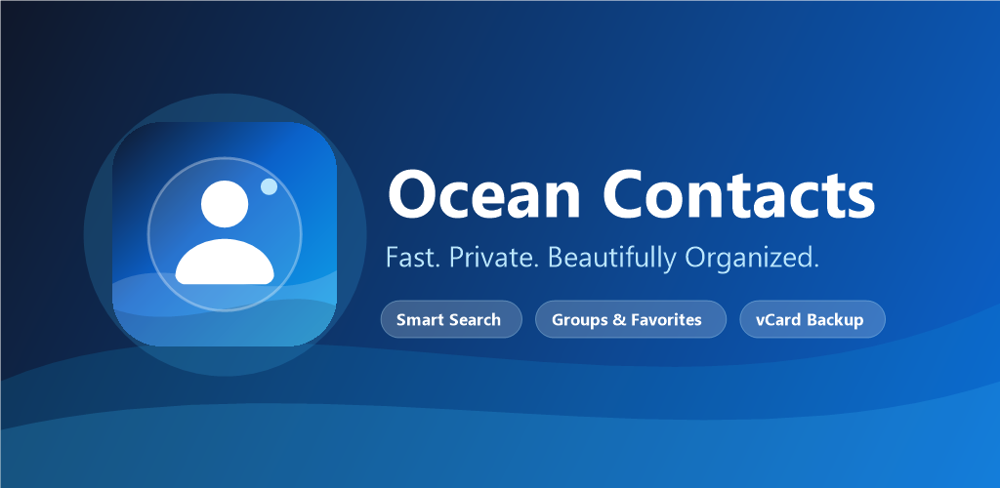

# Ocean Contacts


**Ocean Contacts** (`com.mosamir.oceancontacts`) is a fast, modern, Ocean Blue & Slate Android contacts manager with smart search, groups, favorites, private device-only contacts, and full vCard (`.vcf`) import/export & automatic backups.



## Highlights

- **Smart Search & Custom Fields**: Instantly search contacts, favorites, and groups, and choose which contact fields are displayed.
- **Groups & Favorites**: Organize contacts into groups for quick batch SMS or email, and pin favorite contacts in list or grid view.
- **vCard Backup & Restore**: Export and import `.vcf` files manually or configure scheduled automatic backups.
- **Ocean Blue & Slate Design**: Clean Material theme with custom Ocean Blue & Slate palette, adaptive launcher icon, and frosted contact action controls.
- **AdMob Monetization**: Anchored Adaptive Banner ads via Google Mobile Ads SDK (`debug` builds automatically use Google's official test ad IDs; `release` builds read `ADMOB_APP_ID` and `ADMOB_BANNER_UNIT_ID` from `gradle.properties`).

## Building Releases

1. Set your live AdMob IDs in `gradle.properties`:
   - `ADMOB_APP_ID`
   - `ADMOB_BANNER_UNIT_ID`
2. Ensure `keystore.properties` and `keystore.jks` are configured (gitignored).
3. Build signed Google Play App Bundle (`.aab`) and APK:
   ```powershell
   .\gradlew.bat bundleGplayRelease assembleGplayRelease
   ```

## License

This project is based on open-source software licensed under the **GNU General Public License v3.0 (GPL-3.0)**. See [LICENSE](LICENSE) for full license terms.
